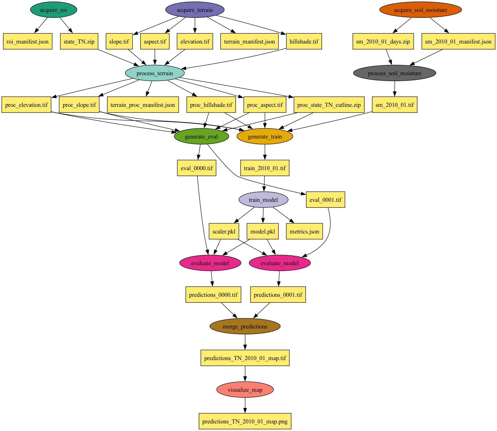

# SOMOSPIE Pegasus Workflow

A Pegasus workflow for SOMOSPIE that downloads terrain and soil-moisture data, trains a RandomForest regressor, and produces downscaled soil-moisture maps for states across the United States

## Overview

This workflow acquires terrain predictors and a GADM state boundary for the region of interest, fetches ESA CCI soil-moisture monthly, trains a RandomForest model on one configured month, runs per-tile inference in a fan-out, and mosaics the predictions into a state map with a shareable figure.

### DAG Visualization

The following diagram shows the SOMOSPIE workflow DAG for a default 2-tile inference configuration for the state of Tennessee:



## Features

- **Config-driven runs**: state, resolution, predictors, months, tiles, and RF settings all live in `config.yml`
- **Per-tile fan-out**: one inference job per eval tile; empty tiles yield all-nodata tiles (DAG-safe)
- **Skip-if-downloaded**: manifests + byte-size reuse checks with `--force` override
- **RandomForest-only**: small randomized search, `model.pkl` + `scaler.pkl` + `metrics.json`
- **Bare or containerized**: default bare interpreter, Apptainer `.sif` 

## Data Sources

- **Terrain predictors**: presigned-URL service (`service_url` + `?state=&resolution=`), one call per region.
- **Region of interest**: GADM USA state boundary.
- **Soil moisture**: ESA CCI v7.1 daily NetCDFs averaged to monthly GeoTIFFs.

## Prerequisites

### Software Requirements

- Python 3.8+
- Pegasus WMS v5.0+
- HTCondor v10.2+
- Apptainer (only on Linux, only to build/run the container)

### Python Dependencies

```bash
pip install -r requirements.txt
```

Job runtime additionally needs GDAL, pandas, scikit-learn, numpy, netCDF4, requests, matplotlib (inside the `.sif`, or a conda env from `Apptainer/environment.yml`).

## Directory Structure

```
somospie-pegasus-workflow/
├── workflow_generator.py          # Pegasus DAG builder (catalogs, jobs, dependencies)
├── config.yml                     # All user settings (state, predictors, months, tiles, RF, viz)
├── dataverse.json                 # Per-file Dataverse fallback URLs
├── requirements.txt               # Submit-host Python dependencies
├── example_usage.sh               # Lightweight walkthrough 
├── run_manual.sh                  # Full local end-to-end run (no Pegasus)
├── bin/
│   ├── acquire_terrain.py         # Presigned-URL predictor download 
│   ├── acquire_roi.py             # GADM state boundary → cutline zip
│   ├── acquire_soil_moisture.py   # ESA CCI month fetch (curl pool, 404-tolerant)
│   ├── process_soil_moisture.py   # Daily NetCDFs 
│   ├── process_terrain.py         # Reproject predictors + validated cutline
│   ├── generate_train.py          # Stack SM + terrain, clip to ROI
│   ├── generate_eval.py           # Multi-tile eval emission
│   ├── train_model.py             # RandomForest + search → model/scaler/metrics
│   ├── evaluate_model.py          # Per-tile inference
│   ├── merge_predictions.py       # VRT mosaic → state map + overviews
│   └── visualize_map.py           # Map PNG figure
├── Apptainer/
│   ├── SOMOSPIE_Container.def     # Container definition (built to a .sif)
│   └── environment.yml            # Matching conda spec for bare mode
├── images/
│   └── somospie_workflow.png      # DAG visualization
└── output/                        # Workflow outputs (Pegasus stage-out)
```

## Quick Start

### 1. Configure the run

Edit `config.yml` (state, predictors, months, `train_month`, `eval_tiles`, RF search, visualization). Each key carries a one-line comment. To run another state without touching the file:

```bash
./workflow_generator.py --state AL --output workflow_AL.yml
```

### 2. Build the Container (Linux only, optional)

Bare mode is the default (no `.sif` needed). For containerized runs, build on a Linux x86_64 host:

```bash
apptainer build Apptainer/SOMOSPIE_Container.sif \
    Apptainer/SOMOSPIE_Container.def
```

### 3. Generate Workflow

```bash
# Default (TN, from config.yml)
./workflow_generator.py --output workflow.yml

# Containerized variant
./workflow_generator.py --container-sif Apptainer/SOMOSPIE_Container.sif \
    --output workflow_container.yml
```

### 4. Submit to HTCondor

```bash
pegasus-plan --submit -s condorpool -o local workflow.yml

# Monitor workflow
pegasus-status <run_directory>
pegasus-statistics <run_directory>
```

### 5. View Results

Deliverables stage out to `output/`:

```
output/
├── predictions_TN_2010_01_map.tif  # State soil-moisture map 
├── map_TN_2010_01.png              # Map figure 
├── model.pkl                       # Trained RandomForest
├── scaler.pkl                      # Fitted StandardScaler
├── metrics.json                    # val_rmse etc. (compare predictor sets here)
├── predictions_0000.tif …          # Per-tile predictions
└── *_manifest.json                 # Acquisition/processing manifests
```

Bulky data intermediates stay in `scratch/` (safe to delete after the run).

## Configuration Options

### Workflow Generator Arguments

| Argument | Description | Default |
|----------|-------------|---------|
| `--config` | Config YAML path | `config.yml` |
| `--state` | Override `region.state` (e.g. TN, AL) | - |
| `--container-sif` | Apptainer image for containerized runs | - (bare mode) |
| `-e, --exec-site` | HTCondor execution site | `condorpool` |
| `--output` | Output workflow file | `workflow.yml` |
| `--submit` | Plan, wait, and report statistics immediately | False |

### Key `config.yml` Settings

| Setting | Description | Default |
|---------|-------------|---------|
| `region.state` / `region.resolution` | State + resolution driving all downloads | TN / 30m |
| `data_sources.terrain.predictors` | Download list AND model features, in order | aspect, elevation, hillshading, slope |
| `data_sources.soil_moisture.months` | Months to download | `[1]` |
| `training.train_month` | Which downloaded month to train on | `1` |
| `inference.n_tiles` / `eval_tiles` | Grid size / tiles to predict (`"all"` = full state) | 6 / 2-tile list |
| `visualization.cmap/dpi` | Figure colormap and resolution | RdBu / 150 |

Uncomment more bucket rasters under `predictors:` to add additional features.

## Helper Scripts

For quick local testing, use the provided scripts:

- `run_manual.sh` runs the full pipeline end-to-end (needs the `somospie` conda env activated).
- `example_usage.sh` shows a lightweight walkthrough (service call, one cutline fetch, generate-only).

## Related Resources

- [Pegasus WMS Documentation](https://pegasus.isi.edu/documentation/)
- [ESA CCI Soil Moisture](https://www.esa-soilmoisture-cci.org/)
- [GADM Boundaries](https://gadm.org/)

## License

Copyright 2026 Global Computing Lab.

This workflow is distributed under the terms of the Apache License, Version 2.0.

See LICENSE and COPYRIGHT for more details.

SPDX-License-Identifier: Apache-2.0